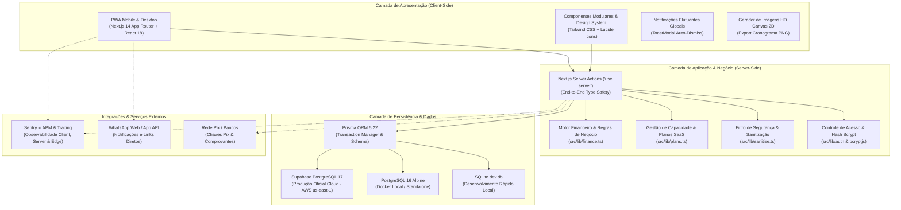
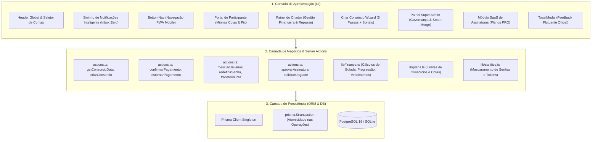
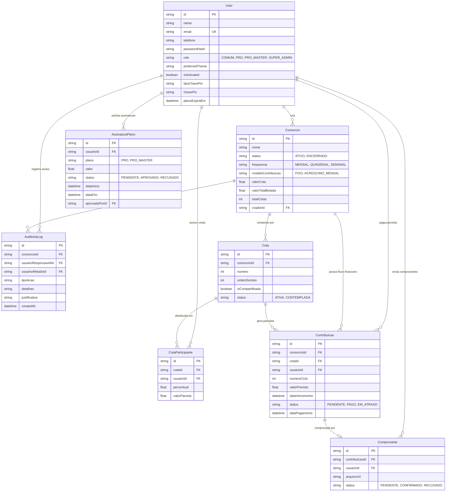
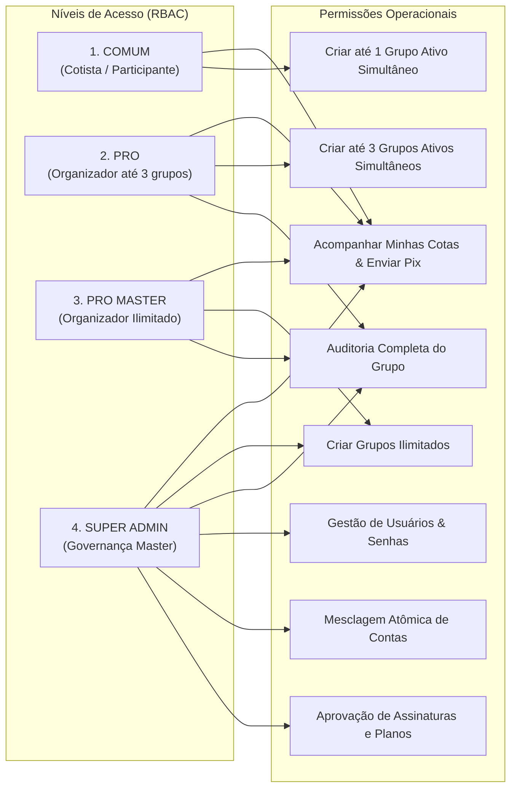
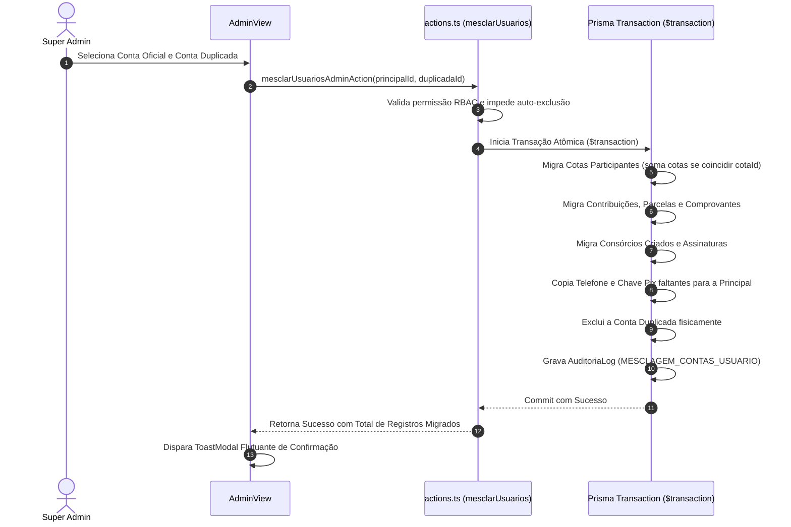
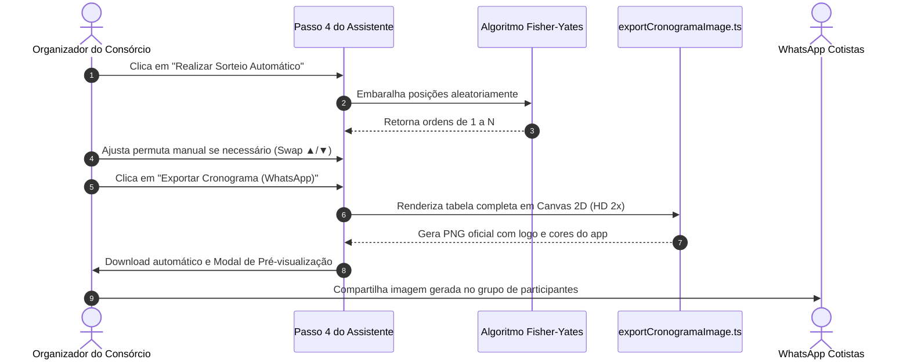
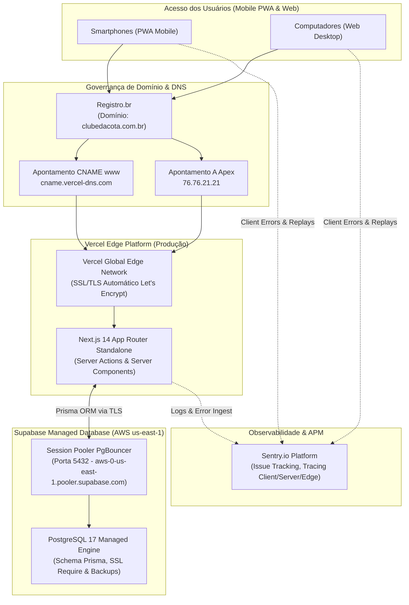
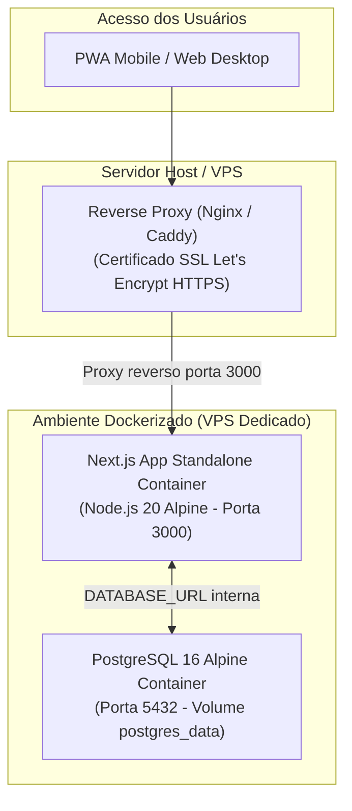

# 🏛️ Desenho de Arquitetura de Sistemas — Clube da Cota

Este documento apresenta a especificação técnica completa e os diagramas arquiteturais do **Clube da Cota**, detalhando as camadas de software, tecnologias adotadas, fluxo de comunicação, modelo de dados relacional e infraestrutura de execução.

---

## 1. Visão Geral e Pilares Arquiteturais

O **Clube da Cota** é uma plataforma moderna desenvolvida com foco em **Mobile-First / PWA**, governança financeira e autoatendimento intuitivo para grupos de consórcio entre amigos e familiares.

---

## 2. Stack Tecnológica Detalhada

| Camada | Tecnologia | Função Principal |
| :--- | :--- | :--- |
| **Hospedagem & CDN** | **Vercel Serverless Platform** | Deploy contínuo, roteamento Edge global, SSL/TLS gerenciado e alta disponibilidade. |
| **Domínio Próprio & DNS** | **Registro.br (`clubedacota.com.br`)** | Registro oficial de domínio com apontamento de DNS autoritativo e subdomínio `www`. |
| **Framework Fullstack** | **Next.js 14.2 (App Router)** | Renderização híbrida (RSC), roteamento moderno e Server Actions com zero overhead REST. |
| **Biblioteca de UI** | **React 18.3 & TypeScript 5.6** | Interface reativa, tipagem estrita de ponta a ponta e estados locais otimizados. |
| **Estilização & Temas** | **Tailwind CSS 3.4** | Design responsivo mobile-first, animações fluidas e suporte a 6 paletas de temas oficiais. |
| **Ícones do Sistema** | **Lucide React** | Conjunto padronizado de ícones semânticos para toda a aplicação. |
| **Renderização Gráfica** | **HTML5 Canvas 2D API** | Geração e exportação client-side de tabelas e cronogramas em alta resolução (PNG 2x scale). |
| **Camada ORM** | **Prisma ORM 5.22** | Modelagem relacional tipada, migrations automatizadas e transações atômicas seguras. |
| **Bancos de Dados** | **Supabase PostgreSQL 17 / SQLite** | Banco em nuvem com Session Pooler (`aws-0-us-east-1`) em produção e SQLite local dev. |
| **Observabilidade & APM** | **Sentry.io (`@sentry/nextjs` 11)** | Monitoramento de performance, alertas em tempo real de erros no cliente, servidor e Edge. |
| **Segurança & Criptografia** | **Bcrypt.js & Crypto** | Hashing seguro de senhas com salt rounds e tokens criptográficos temporários. |
| **Contêineres & DevOps** | **Docker & Docker Compose** | Build multi-stage standalone (~150MB) e orquestração opcional para ambientes dedicados/on-premise. |
| **Suíte de Testes** | **Node.js Test Runner Nativo** | 15 suítes de teste de integração e unidade sem dependências pesadas de terceiros. |

---

## 3. Diagrama de Camadas da Aplicação

---

## 4. Diagrama Entidade-Relacionamento (DER)

O banco de dados relacional é estruturado para garantir rastreabilidade contábil, integridade referencial e auditoria total:

---

## 5. Matriz de Autorização & Níveis de Acesso (RBAC)

O sistema opera com 4 níveis hierárquicos de segurança estrita:

---

## 6. Fluxos Críticos de Negócio

### 6.1. Smart Merge Atômico (Unificação de Contas Duplicadas)
Quando o Super Admin identifica que um participante foi cadastrado duas vezes:

---

### 6.2. Sorteio de Ordem de Contemplação & Exportação HD
No Passo 4 do Assistente de Criação de Consórcio:

---

## 7. Infraestrutura de Deploy & Ambientes

### 7.1. Arquitetura Oficial de Produção (Serverless Cloud & Observabilidade)

A infraestrutura oficial de produção do **Clube da Cota** opera em arquitetura Serverless de alta disponibilidade, com distribuição de borda (Edge Network) e banco de dados gerenciado:

### 7.2. Ambiente Docker Dedicado / On-Premise (Alternativo)

Para implementações em servidores VPS dedicados (ex: Hetzner, DigitalOcean ou AWS EC2):

---

## 8. Cobertura de Testes Automatizados (17 Suítes - 100% de Sucesso)

O sistema possui uma suíte rigorosa de **17 arquivos de testes automatizados**, cobrindo todas as camadas sem necessidade de servidores externos ativos:

1. `tests/finance.test.mjs`: Validação de parcelas, juros, acréscimos e bolada líquida.
2. `tests/auth.test.mjs`: Autenticação real com hash bcrypt e validação dos 4 papéis.
3. `tests/sanitize.test.mjs`: Trava anti-vazamento de tokens e hashes de senha.
4. `tests/participantes_repasse.test.mjs`: Repasse de cotas com integridade contábil.
5. `tests/planos_upgrade.test.mjs`: Capacidade de consórcios por plano.
6. `tests/assinaturas_gestao.test.mjs`: Ciclo de vida e renovação cumulativa SaaS.
7. `tests/consorcio_ciclo_vida.test.mjs`: Regra de 1 ativo simultâneo e congelamento.
8. `tests/consorcio_vencido_gestao.test.mjs`: Alertas de consórcio vencido e CRM de upgrade.
9. `tests/notifications.test.mjs`: Notificações Inbox Zero e privacidade LGPD.
10. `tests/cadastro_participante_link.test.mjs`: Onboarding via link com criação de senha.
11. `tests/perfil_dados.test.mjs`: Edição de perfil, temas e WhatsApp do organizador.
12. `tests/agenda_vinculo_participante.test.mjs`: Agenda com autocomplete preditivo.
13. `tests/sorteio_ordem_contemplacao.test.mjs`: Fisher-Yates e imutabilidade do Sorteio 1.
14. `tests/export_cronograma_image.test.mjs`: Canvas 2D dinâmico e exportação PNG.
15. `tests/admin_gestao_usuarios.test.mjs`: Smart Merge, senhas amigáveis e governança.
16. `tests/pix_pagamento_participante.test.mjs`: Validação e mascaramento de chave Pix no pagamento do participante.
17. `tests/pagination.test.mjs`: Algoritmo universal de paginação em memória e fatiamento de dados.
